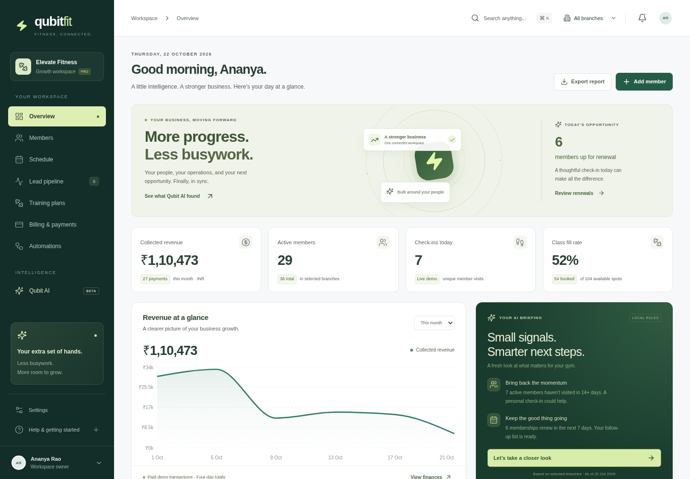

# QubitFit

A working, responsive prototype of an India-first fitness operating system. It connects an operator workspace and a member portal using one shared demonstration dataset.



[View the member experience](docs/prototype-member.png).

## Run on your computer

Use Node.js 24 (22.12 or newer is supported) and npm.

```sh
git clone https://github.com/infinixsys/Qubit-gym.git
cd Qubit-gym
npm ci
npm run dev -- --port 5173
```

Open **http://localhost:5173/** after the server starts. This address refers to the machine running the command; a server started in the cloud workspace does not automatically appear on your computer's localhost.

## Run in the prepared cloud workspace

```sh
cd /workspace/Qubit-gym
npm ci --cache /workspace/.cache/npm
npm run dev -- --port 5173
```

The Vite server listens on all interfaces. No API keys, database, or external services are required.

```sh
npm run build      # TypeScript checks and production assets in dist/
npm run preview    # Serve the production build
npm test           # Domain behavior tests
npm run test:e2e   # Browser workflow, responsive, and accessibility checks
```

Browser tests use system Chromium when available at `/usr/bin/chromium`. Otherwise run `npx playwright install chromium`, or set `PLAYWRIGHT_CHROMIUM_EXECUTABLE` to your browser executable. The test runner starts Vite automatically if it is not already running. Browser tests should be run as one suite to keep their output directories independent from other invocations.

## Try a connected journey

1. **Overview → Add member:** select a plan and choose a pending demonstration payment. The new member remains inactive.
2. **Billing & payments:** find the invoice, open it, and confirm the simulated payment. The member becomes active and collected-revenue totals update.
3. **Members:** open the profile and check in. Repeating the action does not add another visit for the demo day.
4. **Schedule:** choose a future class, reserve an eligible member, and see one credit deducted. A full class offers a waitlist; cancellation restores credit and promotes the first eligible person.
5. **Training plans:** create a structured draft, review and edit its exercises, and explicitly approve publication. Drafts remain unavailable in the member portal.
6. **Member experience:** select the assigned member, complete each workout set, choose perceived effort, and save the session. Completed history appears in the training workspace.
7. **Qubit AI:** ask about renewals, inactivity, missed payments, or utilization. Inspect the underlying records and approve internal follow-up tasks.
8. **Automations:** preview a rule and choose Run now. Tasks are deduplicated and execution appears in the audit history.
9. **Settings:** export the local workspace as JSON or reset it after confirmation. Member and billing views also support CSV exports.

The workspace includes three Bengaluru branches, fictional members and leads, a membership catalog, four months of demonstration payment records, and a week of classes. Use the branch selector to scope operator views. `Ctrl/Cmd + K` opens workspace search.

## Prototype decisions

- React 19, TypeScript, Vite, Lucide icons, and Recharts. Inter is served locally.
- `src/model.ts`: shared domain types, fixtures, selectors, and state transitions.
- `src/store.tsx`: application context, hash navigation, notifications, and local persistence.
- `src/pages/`: operator and member surfaces, using shared accessible UI primitives.
- `src/model.test.ts` and `e2e/`: domain tests and real Chromium journeys.
- [Original PRD](docs/original-prd.txt) and [PRD refinements](docs/PRD-refinements.md): preserved vision, focused MVP, adoption improvements, and production gates.
- [Validation report](docs/validation.md): executed checks, workflow coverage, and their limits. A GitHub Actions workflow repeats the build and test commands on pushes and pull requests.

## Deliberate boundaries

This is a client-side prototype, not a production deployment. Changes are saved in this browser under `qubitfit-demo-v1`. The reporting and class clock is anchored to **22 October 2026, 10:42 AM IST** so scenarios remain reproducible. New audit entries use the actual action time. The demo is not synchronized across browsers or users.

Payments are simulated. No money is collected, no messaging provider is connected, and generated receipts are demonstration records rather than tax invoices. Monetary values use integer paise. No financial security or concurrent database guarantees are implied by local state transitions.

The copilot uses deterministic local rules and approved exercise templates, with no external model calls. Automation requires a manual run. Pain-sensitive training input creates a review-only assessment draft. The prototype does not provide medical advice or validated adaptive coaching.

There is no login, backend, role enforcement, or secure tenant isolation. The member selector is a demonstration control. Browser data is editable and unencrypted; use fictional records only. Native mobile, live payments and communications, biometrics, wearables, marketplace, and platform administration remain production roadmap work.

Before a paid pilot, implement the authenticated transactional backend, database isolation, payment verification and reconciliation, consent and notification delivery, protected health records, backups, monitoring, and the launch gates in the refined PRD. Automated accessibility checks cover selected rendered states and complement, rather than replace, manual assistive-technology testing.
